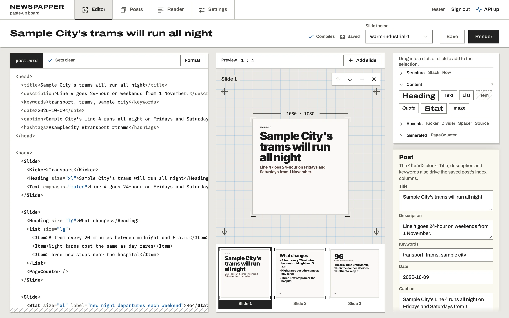
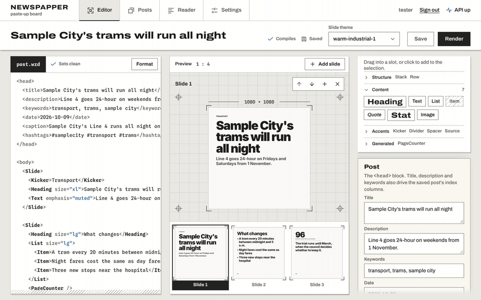
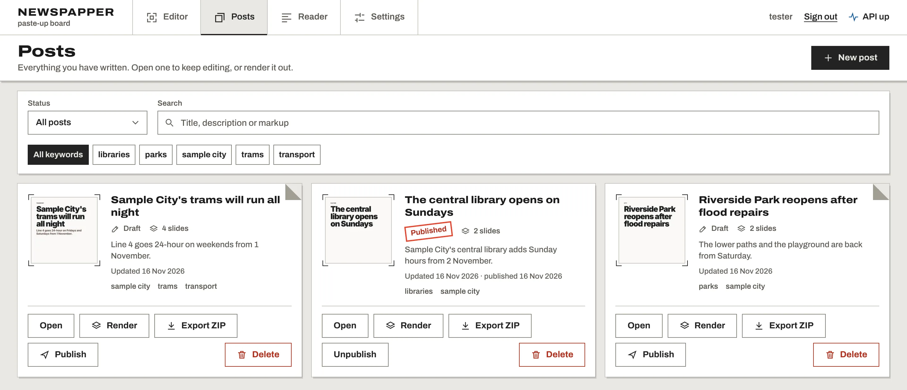
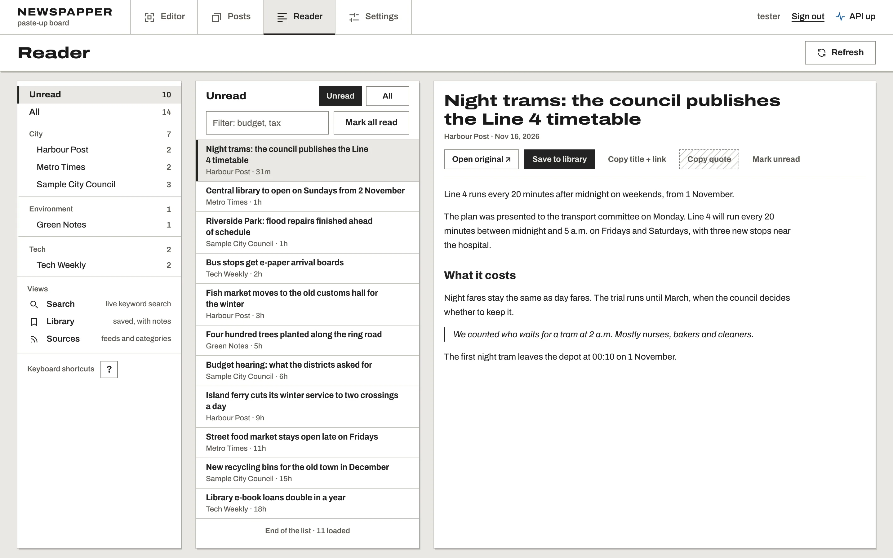
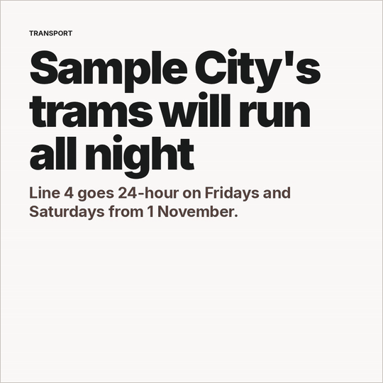
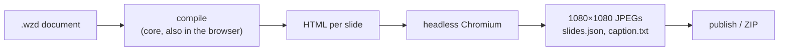

# Newspapper

A web app for writing Instagram-style news posts by hand. You write the post in a small markup language, watch each slide set on a live 1080×1080 canvas as you type, and export the slides as JPEGs with a caption.

<p align="center">
  
</p>

**Status:** Personal project with one user. It runs at `/newspapper/`, behind its own sign-in, with "Sign in with Ward" as a second way in. The Contact sheet redesign shown here (2026-11-13) and the API's new structure (2026-11-11) are on `main` and not deployed yet. Whether production already has the Reader, on `main` since 2026-10-09, is not recorded.

## What it does

- You write a post as a `.wzd` document: a `<head>` with the title, caption and hashtags, then one `<Slide>` per image.
- The working slide redraws on every keystroke, above a strip with every slide of the post. The linter flags an unknown component, a bad prop value or a missing title as you type.
- Render screenshots each slide in headless Chromium and writes 1080×1080 JPEGs, `slides.json` and `caption.txt` to `output/YYYY-MM-DD-N/`.
- Publish runs a one-time JPEG optimisation pass. Export ZIP downloads the run, ready to upload by hand.
- The Reader follows your RSS feeds, searches them by keyword and keeps the items you save, with a note, to write from.

No model writes anything, local or remote; you type every word. Props choose from the theme's named scales and there is no raw CSS field, so a post cannot drift off its theme. It does not post to Instagram or schedule anything. It is built for a desktop browser; on a phone the screens still fit, with Editor, Posts, Reader and Settings in a bottom bar.

## Screenshots



Select text in the source pane and type, and the slide follows. Pick a thumbnail in the strip to put that slide on the stage.



The posts list. Each card shows a thumbnail of the latest render; the middle one has been published.



The Reader, filled with made-up feeds: the feeds by category, the unread items, and one item open with Save to library.

| The four JPEGs one render wrote |
|---|
|  |

## How it works

It is three npm workspaces, and dependencies run one way: `ui → api → core`. `core` holds the `.wzd` parser, formatter, linter and compiler, the Chromium renderer, RSS fetching and SQLite storage. The compiler also runs in the browser, so the editor's preview and the final render come from the same code. `api` is a Fastify server on port 3001; it asks for a session (a local account, or Ward when it is configured) on every `/api/*`, `/output/*` and `/uploads/*` request except the health check, and streams search, render and Reader refresh over server-sent events. `ui` is a Vite + React app on port 4321.



More in the wiki: [architecture](corpus/wiki/architecture.md) and [the `.wzd` language](corpus/wiki/markup.md). A walkthrough of writing one post is in [docs/making-a-post.md](docs/making-a-post.md).

## Run it locally

Requires Node 24, the version the container runs; `package.json` declares no `engines` field. The "Sign in with Ward" button is optional and needs Ward's container in `wzd_auth/infrastructure/local`.

```bash
npm install
node node_modules/playwright/cli.js install chromium   # the renderer's browser (Playwright 1.60)
cp .env.example .env              # Ward's seed.mjs fills in the optional Ward keys
SEED_USERNAME=you SEED_PASSWORD=... npm run seed --workspace=api   # your local account
npm run dev                       # API on :3001, UI on :4321
```

Open <http://localhost:4321/newspapper/> and sign in with the account you seeded, or with the Ward button when Ward is configured. A Ward that is down never stops the API or a local sign-in.

`npm install` fetches no browser. The renderer drives the `playwright` package (1.60). `npx playwright` runs `@playwright/test` (1.63) instead, the runner of the browser specs in `e2e/`, and its `install chromium` fetches a different Chromium build that Render cannot use. The [configuration](corpus/wiki/configuration.md) page lists every env var, and [commands](corpus/wiki/commands.md) lists every npm script, how to run the browser specs, and what each check does not cover.

## Project layout

| Path | What lives there |
|---|---|
| `core/` | `@newspapper/core`: the `.wzd` language, the renderer, RSS and the Reader, SQLite storage, uploads |
| `api/` | `@newspapper/api`: the Fastify server, accounts and the session guard, static serving in production |
| `ui/` | `@newspapper/ui`: the Vite + React app (editor, posts, Reader, settings) |
| `e2e/` | Playwright specs on a stubbed API: focus rings, reduced motion, phone widths, the theme switch, screenshots |
| `assets/` | The three slide themes as JSON tokens, and the Inter fonts the renderer loads |
| `docs/` | The Docusaurus docs site, plus the images and guides this README links to |
| `infrastructure/` | Dockerfile and compose file for the container |
| `corpus/` | The project wiki, its work specs, and the change log |

## Docs

- [docs/](docs/README.md): the post walkthrough, the images used here, and how the docs site is built
- Docs site: `/newspapper/docs/`, rendered from `corpus/` on every build
- Project wiki: [corpus/](corpus/index.md), with [status](corpus/wiki/status.md) and [decisions](corpus/wiki/decisions.md); the redesign is in [decisions-ui](corpus/wiki/decisions-ui.md)
- Before trusting a green command here, read [green-because-nothing-ran.md](corpus/wiki/green-because-nothing-ran.md)

## License

MIT, as declared in `package.json`. There is no LICENSE file in the repo yet.
